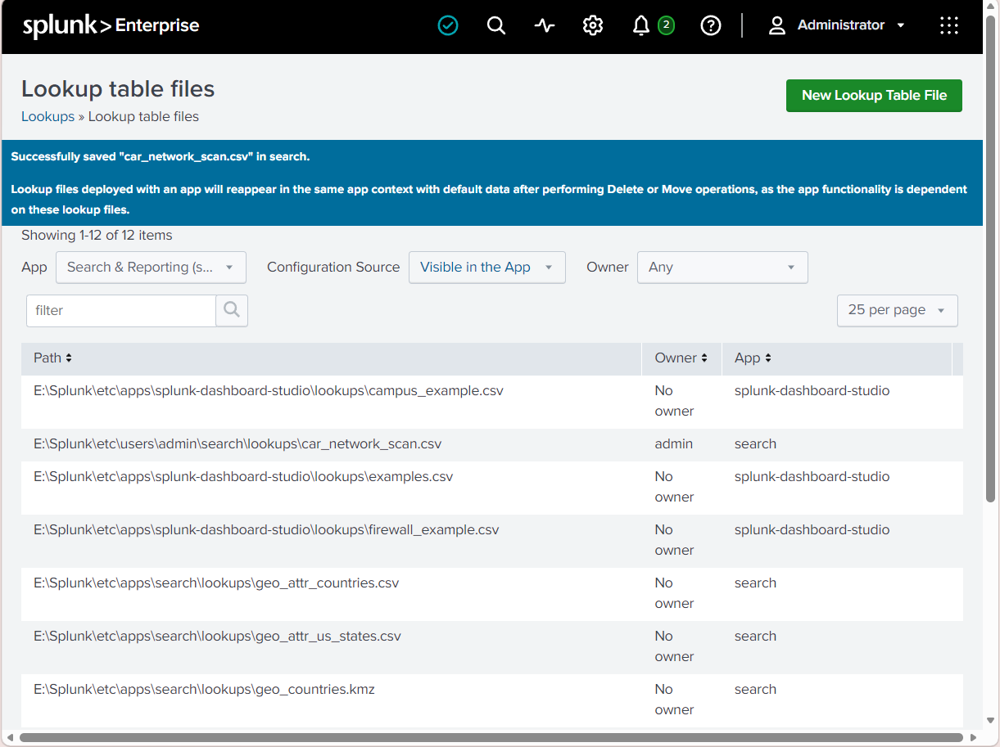
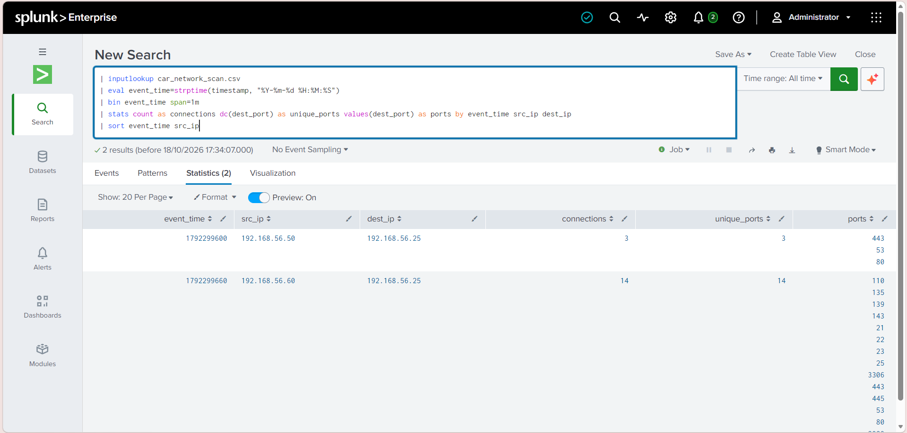
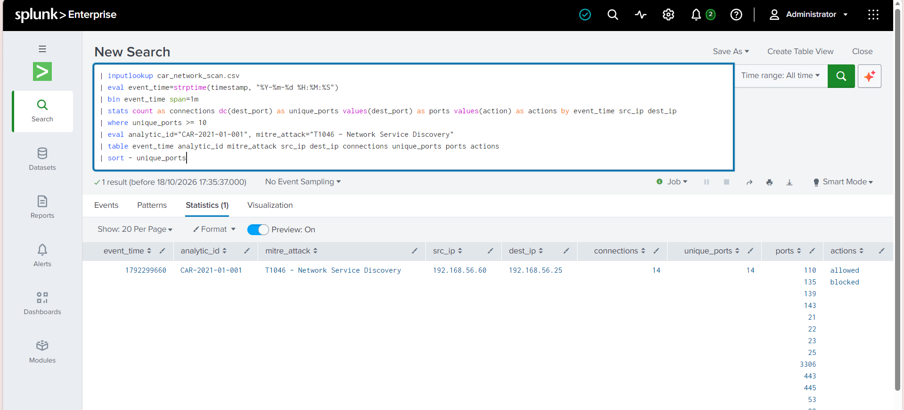
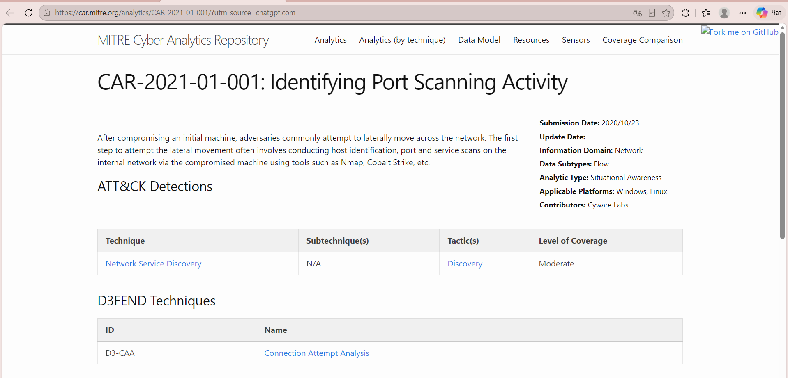

# Week 7 — Using MITRE CAR in Splunk

**Analytic:** MITRE CAR-2021-01-001 — *Identifying Port Scanning Activity*  
**SIEM:** Splunk Enterprise 10.6.0.5 on Windows  
**ATT&CK mapping:** T1046 — Network Service Discovery  
**Dataset:** Synthetic lab data (`car_network_scan.csv`)

## 1. Executive Summary

This lab implemented a simplified port-scanning detection workflow in Splunk using MITRE CAR-2021-01-001 as the reference analytic. The CSV lookup was uploaded successfully. A baseline search grouped records into one-minute windows by source and destination IP and counted distinct destination ports. A detection search then selected groups with at least 10 distinct ports per one-minute window.

The baseline returned two groups: one with 3 connections across 3 distinct ports and another with 14 connections across 14 distinct ports. The detection search returned one group, `192.168.56.60` to `192.168.56.25`, with 14 connections across 14 distinct ports. The result was mapped to ATT&CK T1046, Network Service Discovery, under the Discovery tactic.

**Scope limitation:** the CSV contains synthetic events created for this exercise. The result demonstrates detection of a constructed test case, not a real attack. The SPL is a simplified educational implementation inspired by the CAR reference, not a claim to reproduce every detail of the original analytic.

## 2. Objectives

- Select a detection analytic from the MITRE Cyber Analytics Repository (CAR).
- Load lab data into Splunk.
- Validate the data and detection logic with a baseline query.
- Detect a source contacting multiple destination ports in a short interval.
- Map the behavior to a related MITRE ATT&CK technique.
- Document evidence, findings, false-positive considerations, and limitations.

## 3. Background

Port scanning is a network-reconnaissance behavior used to discover reachable services. A source host contacting many destination ports on one target in a short time can indicate service discovery. This behavior is not automatically malicious: authorized vulnerability scanners, inventory systems, and administrators may produce similar traffic. A SIEM match is an investigation lead, not proof of compromise.

MITRE CAR-2021-01-001 is titled *Identifying Port Scanning Activity*. The official CAR page associates the analytic with Network Service Discovery and the Discovery tactic.

## 4. Environment

| Component | Value |
|---|---|
| Operating system | Windows |
| SIEM | Splunk Enterprise 10.6.0.5 |
| Data source | `car_network_scan.csv` lookup |
| Baseline query | `car_baseline_check.spl` |
| Detection query | `car_2021_01_001_network_scan.spl` |
| CAR analytic | CAR-2021-01-001 |
| ATT&CK technique | T1046 — Network Service Discovery |

## 5. Dataset

The CSV contains 17 synthetic records: 3 baseline records and 14 simulated scan records. Fields include `timestamp`, `src_ip`, `dest_ip`, `dest_port`, `action`, and `protocol`.

| Scenario | Source | Destination | Connections | Distinct ports | Expected outcome |
|---|---|---|---:|---:|---|
| Baseline | `192.168.56.50` | `192.168.56.25` | 3 | 3 | Below threshold |
| Simulated scan | `192.168.56.60` | `192.168.56.25` | 14 | 14 | Meets threshold |

The threshold of **10 distinct destination ports per one-minute bucket** is a lab parameter selected to separate these test cases. It is not a universal production threshold.

## 6. Procedure: Upload the Lookup

1. Open Splunk Enterprise and sign in.
2. Open **Settings → Lookups → Lookup table files**.
3. Select **New Lookup Table File**.
4. Upload `car_network_scan.csv`.
5. Save it in the Search app context with the same filename.
6. Verify the success message confirming that `car_network_scan.csv` was saved in Search.



*Figure 1. Splunk confirms that `car_network_scan.csv` was saved successfully.*

## 7. Baseline Validation

### SPL query

```spl
| inputlookup car_network_scan.csv
| eval event_time=strptime(timestamp, "%Y-%m-%d %H:%M:%S")
| bin event_time span=1m
| stats count as connections dc(dest_port) as unique_ports values(dest_port) as ports by event_time src_ip dest_ip
| sort event_time src_ip
```

### Explanation

- `inputlookup` reads the uploaded lookup table.
- `strptime` converts the timestamp string into Splunk epoch time.
- `bin ... span=1m` groups events into one-minute windows.
- `stats count` counts records; `dc(dest_port)` counts distinct destination ports.
- `values(dest_port)` lists the observed ports.
- Grouping by time, source IP, and destination IP keeps each host pair and time window separate.

### Observed result

Splunk returned two rows:
- `192.168.56.50` → `192.168.56.25`: 3 connections and 3 distinct ports.
- `192.168.56.60` → `192.168.56.25`: 14 connections and 14 distinct ports.

This confirms that the lookup was readable and that the aggregation produced the expected groups.



*Figure 2. Baseline search showing the two groups with 3 and 14 distinct ports.*

## 8. Detection Implementation

### SPL query

```spl
| inputlookup car_network_scan.csv
| eval event_time=strptime(timestamp, "%Y-%m-%d %H:%M:%S")
| bin event_time span=1m
| stats count as connections dc(dest_port) as unique_ports values(dest_port) as ports values(action) as actions by event_time src_ip dest_ip
| where unique_ports >= 10
| eval analytic_id="CAR-2021-01-001", mitre_attack="T1046 - Network Service Discovery"
| table event_time analytic_id mitre_attack src_ip dest_ip connections unique_ports ports actions
| sort - unique_ports
```

### Explanation

- The query reads the CSV, parses the time, and bins records into one-minute windows.
- `stats` calculates connections, distinct ports, port values, and observed action values.
- `where unique_ports >= 10` keeps only groups meeting the lab threshold.
- `eval` adds the CAR analytic identifier and ATT&CK mapping to the output.
- `table` displays the fields needed for review; `sort` orders groups by distinct-port count.

### Observed result

Splunk returned one result:

| Field | Value |
|---|---|
| Analytic ID | `CAR-2021-01-001` |
| ATT&CK mapping | `T1046 - Network Service Discovery` |
| Source IP | `192.168.56.60` |
| Destination IP | `192.168.56.25` |
| Connections | 14 |
| Distinct destination ports | 14 |
| Actions represented | `allowed`, `blocked` |

The simulated scan group met the threshold, while the 3-port baseline group did not.



*Figure 3. Detection search returning the simulated scan group with 14 connections and 14 distinct ports.*

## 9. MITRE ATT&CK Mapping

| Element | Mapping |
|---|---|
| CAR analytic | CAR-2021-01-001 — Identifying Port Scanning Activity |
| ATT&CK technique | T1046 — Network Service Discovery |
| Tactic | Discovery |
| Behavior | One source contacts multiple destination ports on one target in a short time |

This mapping is appropriate for the simulated pattern because the behavior is consistent with discovering network services. It does not prove malicious intent or compromise.



*Figure 4. Official MITRE CAR page for CAR-2021-01-001, showing the analytic title and ATT&CK mapping.*

Official references:
- MITRE CAR: https://car.mitre.org/analytics/CAR-2021-01-001/
- MITRE ATT&CK T1046: https://attack.mitre.org/techniques/T1046/

## 10. Findings and Interpretation

1. The CSV lookup was uploaded successfully.
2. The baseline search returned the two expected test groups.
3. The detection search returned one group with 14 distinct ports in a one-minute window.
4. The result was labelled with CAR-2021-01-001 and T1046.
5. The outcome matches the synthetic test case designed for the lab.

The appropriate conclusion is that the query successfully detected a simulated port-scanning pattern. It is not appropriate to report this as a confirmed real attack.

## 11. Limitations and False Positives

- **Synthetic data:** no real network telemetry was analyzed.
- **Simplified implementation:** this is an educational SPL implementation based on the CAR reference, not an exact reproduction of every original analytic detail.
- **Threshold tuning:** a fixed threshold of 10 ports per minute may not fit all environments.
- **False positives:** authorized vulnerability scanners and inventory tools may contact many ports.
- **False negatives:** slow scans, scans split across time windows, or scans distributed across several sources may not match.
- **Limited context:** the CSV has no asset ownership, user identity, process lineage, or business authorization details.
- **Timestamp assumptions:** the query expects `%Y-%m-%d %H:%M:%S`.

For production use, tune the threshold against normal traffic, enrich results with asset context, document approved scanners, and correlate with firewall, endpoint, DNS, and authentication telemetry.

## 12. Conclusion

The core Week 7 workflow was completed: a MITRE CAR analytic was selected, a lookup was uploaded into Splunk, baseline and detection SPL searches were executed, and the result was mapped to ATT&CK T1046. The baseline returned groups with 3 and 14 distinct ports; the detection query returned the 14-port simulated scan group.

This demonstrates the basic workflow of detection engineering: prepare data, validate the baseline, implement a detection condition, inspect results, map the behavior to ATT&CK, and document limitations. The conclusion remains limited to the synthetic dataset used in this lab.

## 13. Evidence Checklist

The four actual screenshots are embedded above and included in `evidence/`:
- `week7_lookup_upload.png`
- `week7_baseline.png`
- `week7_car_detection.png`
- `week7_mitre_car.png`

## References

1. MITRE Cyber Analytics Repository, **CAR-2021-01-001: Identifying Port Scanning Activity** — https://car.mitre.org/analytics/CAR-2021-01-001/
2. MITRE ATT&CK, **T1046: Network Service Discovery** — https://attack.mitre.org/techniques/T1046/
3. Course Week 7 topic: **Using MITRE CAR (Cyber Analytics Repository)** — select a CAR analytic, implement it in a SIEM, and map it to related ATT&CK techniques.

---
*Educational lab report. The supplied CSV is synthetic; screenshots document the actual lab steps and results.*
